<p align="center">
  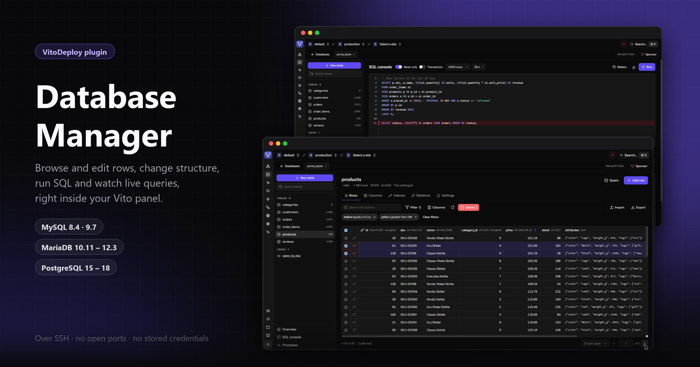
</p>

<h1 align="center">Database Manager for VitoDeploy</h1>

<p align="center">
  <b>Browse and edit rows, change structure, run SQL and watch live queries, right inside your Vito panel.</b><br>
  MySQL · MariaDB · PostgreSQL · over SSH · no open ports · no extra credentials
</p>

<p align="center">
  <a href="https://github.com/Ghanemalk/vito-database-manager/actions/workflows/tests.yml"></a>
  <a href="https://github.com/Ghanemalk/vito-database-manager/releases"></a>
  <a href="https://vitodeploy.com/docs/plugins"></a>
  
  
  
  <a href="LICENSE"></a>
  <a href="https://github.com/sponsors/Ghanemalk"></a>
</p>

---

[VitoDeploy](https://vitodeploy.com) creates your databases, users and backups. This plugin adds the part that was
missing: a real database client that opens from the **Databases** page. You can browse a table, fix a row, add an index,
run a migration script by hand or find the query that is locking everything. You don't need to open port 3306 or 5432,
create a database user for yourself, or install anything on the server.

It talks to each database the way Vito already does: over Vito's own SSH connection, through the server's own `mysql`,
`mariadb` or `psql` client. Nothing new runs on the server, and no password is stored anywhere.

> [!NOTE]
> This is a community plugin. It is not made, endorsed or supported by the VitoDeploy project.

## Contents

- [Highlights](#highlights)
- [Feature tour](#feature-tour)
- [Supported databases](#supported-databases)
- [Requirements](#requirements)
- [Installation](#installation)
- [Usage](#usage)
- [Keyboard shortcuts](#keyboard-shortcuts)
- [Security model](#security-model)
- [How it works](#how-it-works)
- [Limits](#limits)
- [Troubleshooting](#troubleshooting)
- [FAQ](#faq)
- [Development and testing](#development-and-testing)
- [Sponsoring](#sponsoring)
- [Contributing](#contributing)
- [License](#license)

## Highlights

- **One click from Vito.** Every database on the Databases page gets an **Open** button.
- **A data grid built for real tables.** It has server-side paging, sorting, a search across every column, 18 filter
  operators, column picking and bulk delete. Large values are trimmed in the grid and load in full when you open the row.
- **A row editor that knows your types.** JSON gets validation and formatting. Enums and booleans become selects and
  sets become checkboxes. Binary columns get a hex editor plus file upload and download, and any value can be set to `NULL`, `DEFAULT` or a SQL
  function such as `NOW()`.
- **Structure changes with a preview.** You can create tables and add, change or drop columns, indexes, foreign keys
  and check constraints. Every form shows the exact SQL before it runs.
- **A proper SQL console.** It runs multi-statement scripts with syntax highlighting, keeps your history and has a
  read-only mode, a transaction mode, timeouts and row limits. Errors point to the failing statement and line.
- **Live processes.** See what is running on the server right now and stop a query or a whole connection.
- **CSV import and CSV / JSON / SQL export,** with column mapping and insert, skip or upsert modes.
- **Safe by default.** Destructive actions ask you to type the table's name. Every change is written to an audit log,
  and only people who can already change the server in Vito get in.
- **Part of Vito, not a separate app.** The manager opens inside Vito's own layout, with Vito's header and navigation
  rail still in place. It follows Vito's light or dark theme the moment you switch it, and it works on a phone.
- **Zero dependencies.** No Composer packages, no npm build and no scripts from a CDN. It uses only PHP plus plain
  JavaScript and CSS served by Vito itself.

## Feature tour

### Opens from the Databases page

The plugin adds an **Open** button to every database and a **Database Manager** button to the page header. Vito's
page itself is not modified on disk.

**Open** shows the manager in place of the list, below Vito's header. Vito's navigation rail stays on the left, and
the server menu folds away while the manager is open, so the manager's own table list is the only one on screen. The
address bar follows along (`/servers/1/database?manager=3#/table/-/orders`), so reloading the page, sharing the link
or pressing the browser's back button all work. **← Databases** brings the list back.

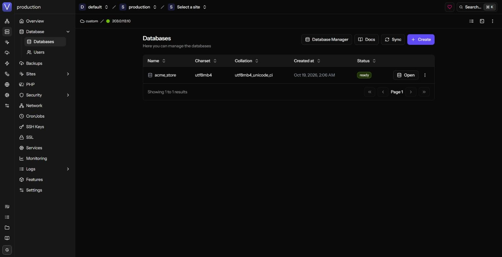

### Overview

The overview shows sizes, row estimates, engines and comments for every table and view, plus the database's routines
and triggers. The sidebar lists tables and views with their row counts, and <kbd>/</kbd> jumps to its search box.

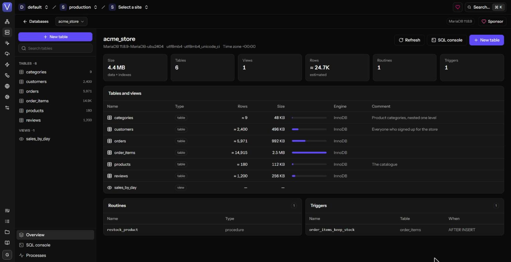

### Rows

Sort by any column, combine filters (`equals`, `contains`, `between`, `is one of`, `matches regex`, `is NULL` and
more), search across every column at once, choose which columns to show and select rows for bulk delete. Column
headers show each column's type, and keys are marked.

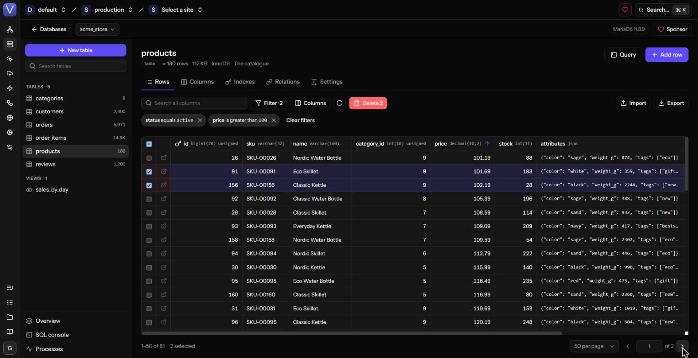

### Row editor

Each column gets an input that fits its type. JSON is checked as you type and can be reformatted, `NULL` is a
checkbox, and the ⚡ menu sets a value to `DEFAULT` or to a function. **Duplicate** starts a new row from this one,
and closing with unsaved changes asks first.

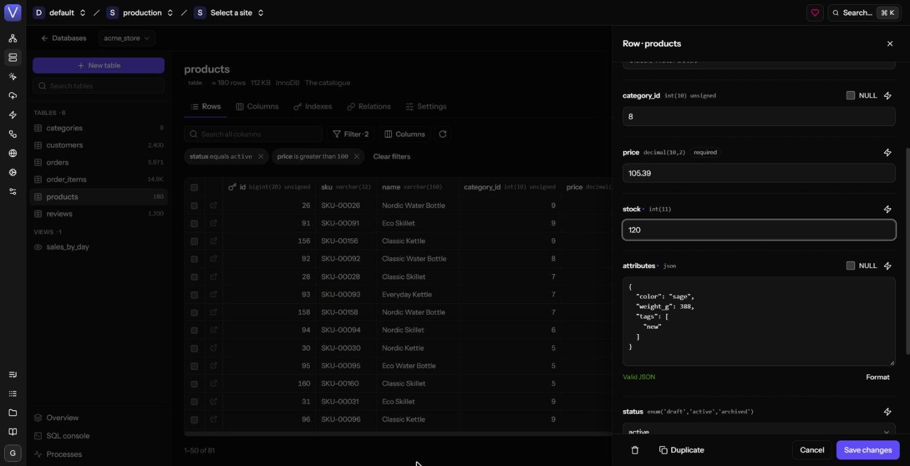

### Create tables

Build a table column by column. You choose keys, nullability, auto-increment, defaults and comments, and you can add
`created_at` / `updated_at` timestamps with one switch. The SQL updates as you type.

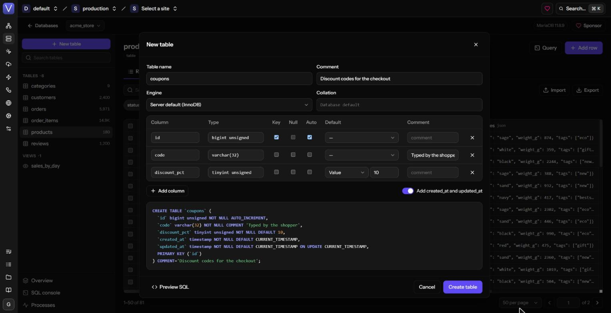

### Columns and indexes

See every column's type, collation, nullability, default and comment. You can add, change or drop a column, and on
MySQL and MariaDB you can choose where a new column goes. The **Indexes** tab adds and drops indexes: unique,
full-text, spatial and prefix indexes on MySQL and MariaDB, and every index method (B-tree, hash, GiST, SP-GiST, GIN,
BRIN) on PostgreSQL, with optional partial and concurrent builds.

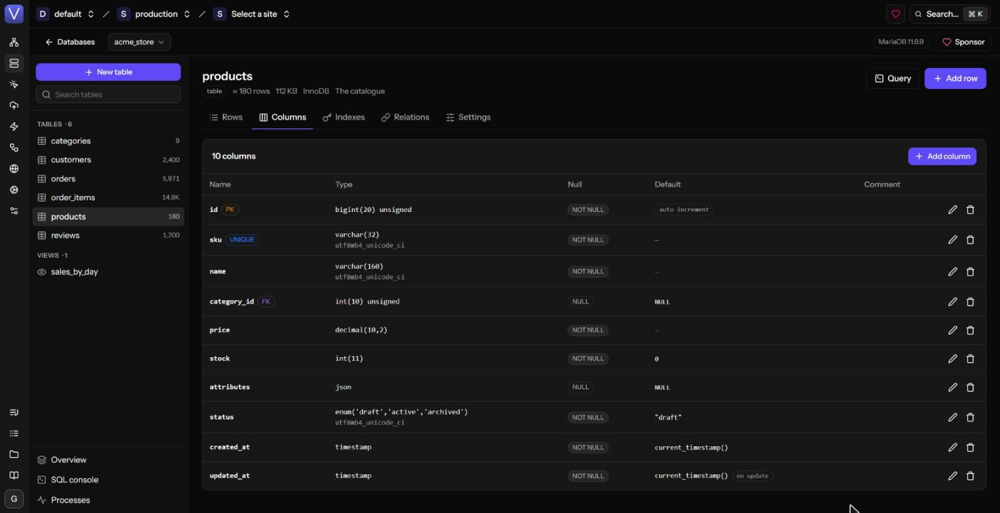

### Relations

The **Relations** tab shows foreign keys in both directions, with their `ON DELETE` and `ON UPDATE` rules, along with
check constraints. Adding one shows a preview, and if the server rejects it, the database's own error appears in the
dialog.

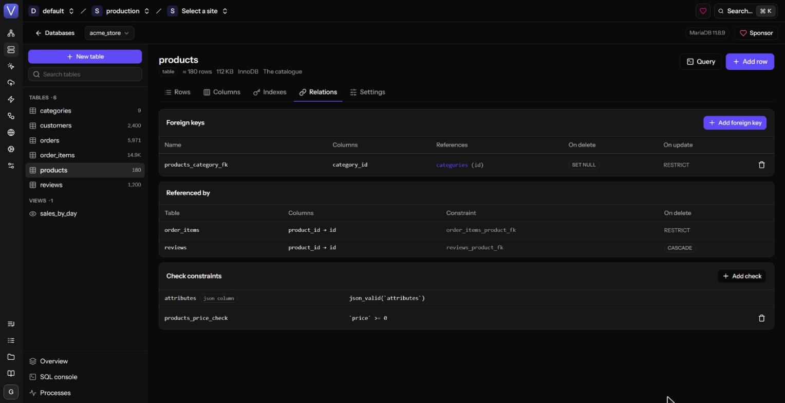

### SQL console

The console runs any script, from a single `SELECT` to a migration of thousands of statements. **Read-only** refuses
anything that could change data. **Transaction** rolls the whole script back if one statement fails. When a statement
fails, its line is highlighted and the console tells you which earlier statements already ran.

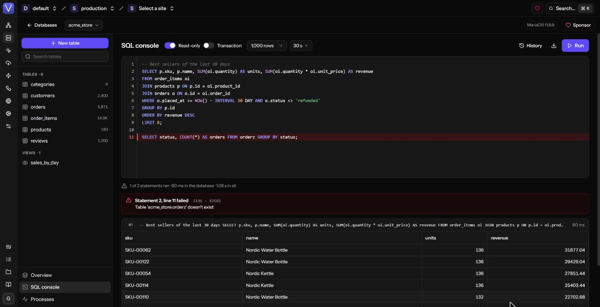

### Processes

See the server's uptime, connections, cache hit rate, lock waits and traffic, along with every running query. The page
refreshes every 3 seconds. **Kill query** stops a statement and **Kill** closes its connection. On PostgreSQL these
are **Cancel** and **Terminate**. The manager's own
connection is labelled, so you won't kill it by mistake.

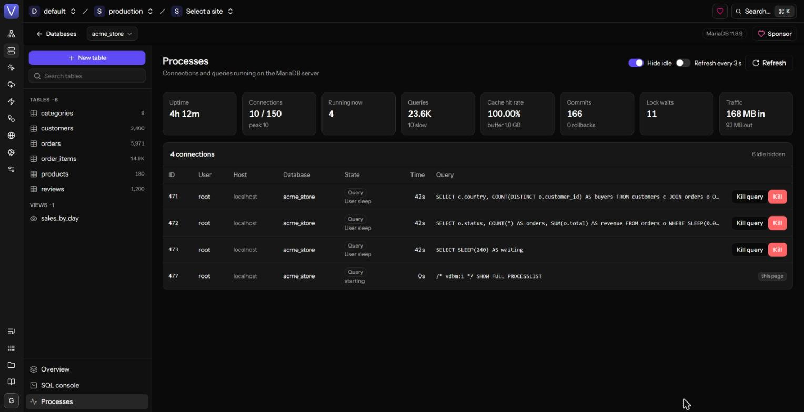

### Light mode and phones

The manager follows Vito's appearance setting (light, dark or system) and changes with it straight away, without a
reload. On small screens the table list becomes a drawer behind the ☰ button.

| Light mode | On a phone |
|:---:|:---:|
| 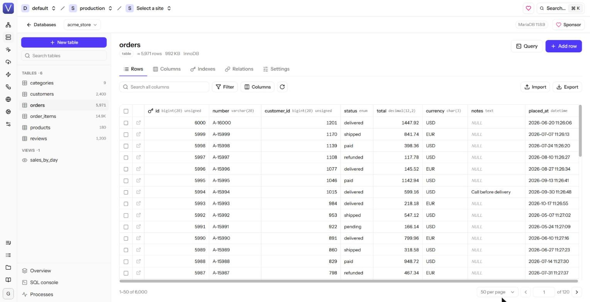 | 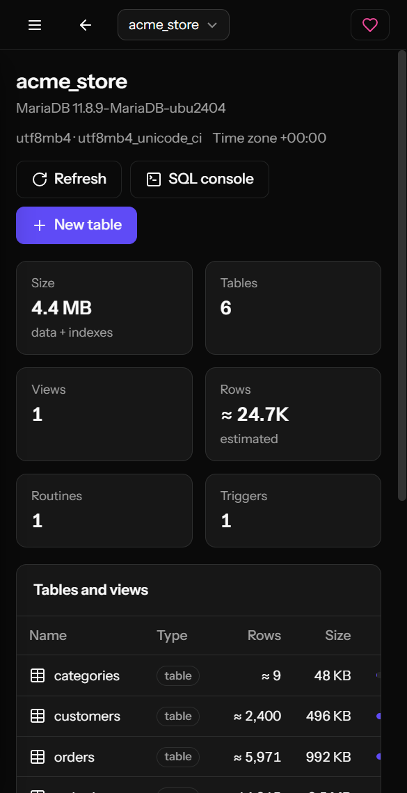 |

## Supported databases

The manager works with the database service Vito installed on the server.

| Engine | Version | Last verified with | Integration checks |
|---|---|---|:---:|
| MySQL | 8.4 LTS | 8.4.11 | ✅ 130 / 130 |
| MySQL | 9.7 | 9.7.2 | ✅ 131 / 131 |
| MariaDB | 10.11 LTS | 10.11.19 | ✅ 130 / 130 |
| MariaDB | 11.4 LTS | 11.4.13 | ✅ 130 / 130 |
| MariaDB | 11.8 LTS | 11.8.9 | ✅ 131 / 131 |
| MariaDB | 12.3 | 12.3.3 | ✅ 131 / 131 |
| PostgreSQL | 15 | 15.19 | ✅ 122 / 122 |
| PostgreSQL | 16 | 16.15 | ✅ 122 / 122 |
| PostgreSQL | 17 | 17.11 | ✅ 122 / 122 |
| PostgreSQL | 18 | 18.6 | ✅ 122 / 122 |

The [integration suite](tests/integration.php) runs against the official Docker image of every version above, on
every push and pull request. It covers rows, all the common column types, structure changes, the console, processes, import,
export and injection attempts. Versions in between will very likely work, and versions outside these ranges may
work.

**PostgreSQL extras:** schemas, identity columns, arrays, `bytea`, partitioned tables, materialized views, row level
security status, and the `VACUUM` / `ANALYZE` / `REINDEX` maintenance tasks.<br>
**MySQL and MariaDB extras:** column positions, `ON UPDATE` timestamps, enums and sets, `bit`, prefix and full-text
indexes, and the `OPTIMIZE` / `ANALYZE` / `CHECK` / `REPAIR` / `CHECKSUM TABLE` maintenance tasks.

## Requirements

| | |
|---|---|
| **VitoDeploy** | 4.x (developed and tested on 4.1) |
| **Server** | a server managed by Vito, with Vito's MySQL, MariaDB or PostgreSQL service installed and the server in the *ready* state |
| **SSH user** | Vito's server user with passwordless `sudo`. Vito sets this up when it provisions a server. |
| **Browser** | any current Chrome, Edge, Firefox or Safari |

Nothing is installed on the database server, and the plugin has no Composer or npm dependencies.

## Installation

### From GitHub, in Vito (recommended)

1. In Vito, open **Admin → Plugins** and choose **Install**.
2. Paste `https://github.com/Ghanemalk/vito-database-manager` and confirm. Vito downloads the latest release.
3. Find **Database Manager** in the list of installed plugins and choose **Enable**.
4. Open any server's **Databases** page. Each database now has an **Open** button.

The plugin is also listed in the **Available** tab of **Admin → Plugins**, among Vito's community plugins, where
**Install** does the same as steps 1 and 2. Updates appear in the **Installed** tab when a new release is published
(**Check for Updates**).

### Manually

Vito loads plugins from `app/Vito/Plugins/<Vendor>/<Name>`. Both folder names must be valid PHP names (letters and
digits, no dashes). The plugin works under any vendor and name you choose.

```bash
cd /path/to/vito/app/Vito/Plugins
mkdir -p Community
git clone --depth 1 --branch v1.0.0 https://github.com/Ghanemalk/vito-database-manager Community/VitoDatabaseManager
chown -R www-data:www-data Community        # the user PHP runs as
```

If Vito runs in Docker, copy the folder into the container instead:

```bash
docker cp vito-database-manager vito:/var/www/html/app/Vito/Plugins/Community/VitoDatabaseManager
docker exec vito chown -R www-data:www-data /var/www/html/app/Vito/Plugins/Community
```

Then open **Admin → Plugins → Discovered**, **Install** the plugin and **Enable** it.

> [!TIP]
> If Vito runs in Docker, keep `app/Vito/Plugins` on a volume so your plugins survive when the image is upgraded.

### Uninstalling

Disable the plugin, then uninstall it from **Admin → Plugins**. The plugin creates no tables and changes nothing
in Vito's database. You can delete its audit log at `storage/logs/database-manager.log` and its temporary files in
`storage/app/database-manager/`.

## Usage

**Opening a database.** Use the **Open** button next to a database on the Databases page. Inside the manager, the
switcher at the top left moves between the server's databases, and **← Databases** takes you back to the list.
<kbd>Ctrl</kbd>-click or middle-click **Open** to open the database in a new tab.

**Browsing.** Pick a table in the sidebar. Click a column header to sort, use **Filter** for conditions and the search
box to look in every column at once. **Columns** chooses which columns to show, and the page size goes from 25 to 500
rows.

**Editing.** Click a row's open icon to edit it, use **Add row** to insert one, or tick rows and choose **Delete**.
Changes are matched by the primary key or a unique key. A table without either is still editable: on MySQL and
MariaDB the row is found by a hash of its full contents, and on PostgreSQL by its `ctid`. If the row changed since you
loaded it, you are told to reload instead of overwriting someone else's change.

**Structure.** The **Columns**, **Indexes** and **Relations** tabs change structure, and every change shows its SQL
first. **Settings** holds the table's comment, its engine, collation and next auto-increment value (MySQL and
MariaDB), and the maintenance tasks. It
also has **Duplicate** (with or without data), **Rename**, **Move** to another schema (PostgreSQL), **Empty**, **Drop**
and the table's full `CREATE` statement to copy or download.

**Import and export.** **Import** takes a CSV file. You map its columns to the table's columns, preview sample values
and choose to insert, skip duplicates or upsert. **Export** writes CSV, JSON or SQL `INSERT`s, optionally with the
`CREATE TABLE`. It exports either the whole table or just the rows that match the current filters and sort.

**SQL console.** Open it from the sidebar or with **Query** on a table. The toolbar has:

| Option | What it does |
|---|---|
| **Read-only** | Refuses any statement that could write before anything runs, then also runs the session as `READ ONLY` on the server |
| **Transaction** | Wraps the script in one transaction, so a failed statement rolls back everything before it |
| **Rows** | The most rows shown per result set (1,000 by default, up to 10,000) |
| **Timeout** | The most time a statement may take (30 s by default, up to 50 s) |
| **History** | Your last 50 scripts on this database, kept in your browser |
| **Download** | Saves the editor's contents as a `.sql` file |

**Processes.** This page lists the server's connections and queries. **Hide idle** keeps the list short, and
**Refresh every 3 s** keeps it live.

## Keyboard shortcuts

| Keys | Where | Action |
|---|---|---|
| <kbd>Ctrl</kbd> + <kbd>Enter</kbd> | SQL console | Run the script, or only the selected text if there is a selection |
| <kbd>Tab</kbd> / <kbd>Shift</kbd> + <kbd>Tab</kbd> | SQL console | Indent / outdent the current line or selection |
| <kbd>Ctrl</kbd> + <kbd>Enter</kbd> or <kbd>Ctrl</kbd> + <kbd>S</kbd> | Row editor | Save the row |
| <kbd>Enter</kbd> | Search, filters, confirmations | Apply / confirm |
| <kbd>/</kbd> | Anywhere outside a text field | Jump to the table search in the sidebar |
| <kbd>Esc</kbd> | Drawers and dialogs | Close (and ask first if there are unsaved changes) |

On macOS, <kbd>⌘</kbd> works wherever <kbd>Ctrl</kbd> is listed.

## Security model

A database client inside a control panel is a powerful thing. These are the rules the plugin follows.

**Who can open it.** Opening the manager, and every request it makes, requires Vito's `update` permission on **both**
the server and the database. In Vito that means the **Owner** or **Admin** role in the server's project. A database
is only reachable through the server it belongs to, and any other combination returns 404.

**Why Vito's read-only role is refused.** The manager connects as the server's administrative database account:
`root` over the local socket on MySQL and MariaDB, and `postgres` on PostgreSQL. That is the same access Vito itself
uses. A Vito user with the read-only **User** role must not get SQL access as a superuser, and the console's read-only
toggle is a guard against mistakes, not a permission boundary. So these users don't see the **Open** buttons, and the
manager's pages and API return 403 for them.

**How it connects.**

- Every request opens Vito's own SSH connection to the server, with the key Vito already holds, and runs the server's
  `mysql`, `mariadb` or `psql` client through `sudo -n`.
- The SQL goes over the SSH channel's standard input, so it never appears in a process list or a shell history.
- No database port is opened, no database user is created and no password is stored or even known by the plugin.

**What it sends to the database.**

- Values are encoded as dialect-correct literals and identifiers are always quoted.
- Filter operators, types, functions and options come from fixed allow-lists.
- The integration suite tries SQL and shell injection through names, values, filters and console scripts on every
  engine, and checks on the server that none got through.

**In the browser.**

- Every API call is a `POST` protected by Laravel's CSRF token.
- Pages are sent with `Cache-Control: no-store`, `Referrer-Policy: same-origin` and a `noindex` robots tag.
- The manager's page carries `Content-Security-Policy: frame-ancestors 'self'`, so only Vito itself can show it in a
  frame. The frame and Vito's page talk through `postMessage`, and only messages for and from Vito's own origin and
  the manager's own frame are used.
- Static files are served by the plugin itself with `nosniff`. No third-party scripts are loaded. The one outside
  request is the Instrument Sans font from `fonts.bunny.net`, the same font Vito's own pages load.

**Confirmations.** Dropping or emptying a table asks you to type its name. Dropping a column, an index or a
constraint, deleting rows, and stopping a query or a connection all ask first and show what will run.

**Audit log.** Every change and every console script is appended to `storage/logs/database-manager.log` in Vito, with
the time (UTC), the user's id and email, their IP, the server, the database, the operation, its outcome and its
details. That covers inserts,
updates, deletes, imports, structure changes, SQL scripts, killed processes and exports. Reads and SQL previews are not
logged.

```text
[2026-10-19T14:02:11Z] user=1 <admin@example.com> ip=203.0.113.7 server=3 db=shop op=ddl ok :: {"action":"drop_index","table":"orders","name":"orders_status_idx"}
```

Found a vulnerability? Please report it privately. See [SECURITY.md](SECURITY.md).

## How it works

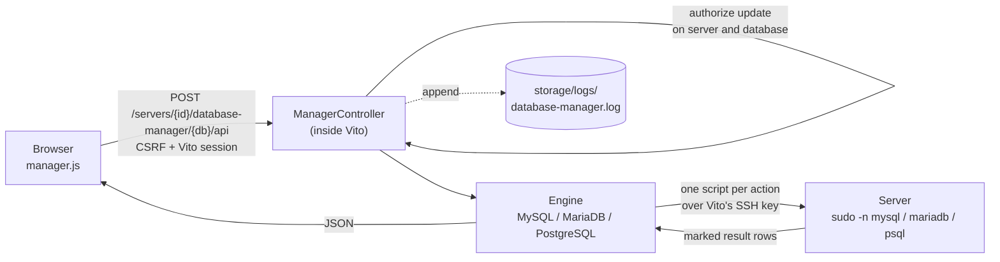

- **`Plugin.php`** registers the views and four routes, then adds a middleware that injects a small launcher script
  into Vito's full page loads. The launcher puts the **Open** buttons on the Databases page, which is a React page
  the plugin cannot edit directly.
- **`resources/assets/launcher.js`** also hosts the manager. When the address has `?manager=<id>`, it places a frame
  with the manager's page (`/servers/{id}/database-manager/{db}?embed=1`) in Vito's content area and folds Vito's
  server menu down to its icon rail. The frame keeps the two apart, so neither side's styles or scripts can affect
  the other. The manager reports its view back through `postMessage`, and the launcher writes it to the address bar.
  It watches Inertia's navigation events, so the frame goes away as soon as you open another Vito page. If Vito's
  layout ever changes so that there is nowhere to put the frame, the launcher opens the manager on a page of its own
  instead (`?standalone=1`).
- **`src/Vito/ManagerController.php`** serves the page and the JSON API. It checks permissions, writes the audit log,
  stores large scripts in parts and builds an engine for the database.
- **`src/Engines/`** turns each action into one script for the server's CLI client. It reads the results back through
  marker lines, so values, `NULL`s and binary data survive intact. Table metadata is cached in Vito's cache and
  refreshed when a statement reports that the cache is out of date.
- **`src/Sql/Splitter.php`** splits scripts into statements the way each server does, covering quotes, comments,
  the `mysql` client's `DELIMITER` lines and PostgreSQL's dollar quoting. It is what makes per-line errors and read-only checks possible.
- **`resources/assets/`** holds the whole UI as plain JavaScript and CSS. There is no framework and no build step.

**A note for plugin authors:** Vito caches its routes, so `route('…')` cannot see the names of routes a plugin
registers at boot. This plugin builds its URLs from paths instead.

## Limits

| Limit | Value | Why |
|---|---|---|
| Time per request | 55 s, statements up to 50 s | Vito's web server gives up on a request after 60 seconds |
| Output per request | 64 MB | Keeps PHP's memory in check. The grid trims long values, and opening a row loads them in full. |
| Rows per console result | 10,000 | Use **Export** for bigger result sets |
| Script size | 50 MB | Larger scripts are uploaded in parts. For full dumps, use Vito's **Backups**. |
| Connection | one SSH connection per action | It adds about half a second to each action, and nothing is left running between actions |

Some behaviour comes from the engines themselves:

- On MySQL and MariaDB, **Duplicate** without data uses `CREATE TABLE … LIKE`, which does not copy foreign keys.
  Add them again on the copy if you need them.
- MariaDB stores `JSON` as `LONGTEXT` with a `json_valid()` check named after the column. The manager shows those
  columns as `json` and labels their check *json column*, without a drop button, so you can't remove it by accident.
- `COPY … FROM STDIN` / `TO STDOUT` and `COPY … PROGRAM` cannot run in the console. Use `INSERT`, a `SELECT`, or
  **Import** and **Export**.
- On MySQL and MariaDB the console always reads backslashes as escapes, so `NO_BACKSLASH_ESCAPES` cannot be turned on
  there.

## Troubleshooting

<details>
<summary><b>The Open buttons are gone, or the plugin shows as disabled</b></summary>

If a plugin fails to load even once, Vito switches it off to protect the panel. This can happen while files are still
being copied during a manual update. Check the plugin's logs in **Admin → Plugins**, fix the cause, and choose
**Enable** again. From the command line:

```bash
php artisan tinker --execute="app(App\Actions\Plugins\EnablePlugin::class)->handle(App\Models\Plugin::where('name', 'Database Manager')->first());"
```
</details>

<details>
<summary><b>"Vito could not log in to the server over SSH" or "could not reach the database server"</b></summary>

The manager uses the same SSH connection as the rest of Vito. If other Vito actions on that server also fail, fix the
server's connection in Vito first. If only the manager fails, check that Vito's server user can run
`sudo -n mysql -e 'SELECT 1'` (or `sudo -n -u postgres psql -c 'SELECT 1'`) without a password prompt.
</details>

<details>
<summary><b>The manager opens on a page of its own instead of inside Vito</b></summary>

The launcher falls back to a full page when it cannot find Vito's content area within a few seconds, or when the
frame does not load the manager (for example after your session expired). Everything still works there, and
**← Databases** takes you back to Vito. If it happens every time, your Vito version may have a different layout:
please [open an issue](https://github.com/Ghanemalk/vito-database-manager/issues) with the Vito version. A proxy that
sends `X-Frame-Options: DENY` for Vito's pages also stops the frame. `SAMEORIGIN` is fine.
</details>

<details>
<summary><b>The manager returns 403</b></summary>

Your role in the server's project is **User** (read-only). Ask a project owner to make you an **Admin**. The
[security model](#security-model) explains why.
</details>

<details>
<summary><b>The manager returns 404</b></summary>

Either the server has no database service in Vito, or the database belongs to a different server. Open the
manager from the Databases page of the server the database lives on.
</details>

<details>
<summary><b>A long query stops with a timeout</b></summary>

Requests are capped at 55 seconds because Vito's web server stops waiting at 60. Raise the console's timeout (up to
50 s) for slow statements. For longer jobs, use a cron job or an SSH session, and use **Backups** for full dumps and
restores.
</details>

<details>
<summary><b>I updated the files by hand and nothing changed</b></summary>

Reload PHP-FPM, or restart Vito's container, so PHP drops its cached copy of the old code, then refresh the page.
The browser picks up the new JavaScript and CSS on its own, because their URLs change whenever the files do.
</details>

## FAQ

**Does it work with databases Vito did not create?**
Yes. It works with any database Vito lists on the server. Use **Sync** on the Databases page to pick up databases
created outside Vito.

**Can I connect to a remote or managed database (RDS, Cloud SQL…)?**
No. The manager works through the database service Vito runs on the server itself.

**Does it store any credentials?**
No. It uses the SSH key Vito already holds and the local administrative account on the server. It never stores or
sees a database password.

**Can several people use it at the same time?**
Yes. Each action is its own short connection. If a row changed since you loaded it, you are asked to reload rather
than overwriting the newer data.

**Is it safe on production?**
It is built for production. It requires a role that can already change the server, refuses writes in read-only mode,
offers transactions, asks before destructive actions and logs every change. It is still a superuser client, so treat
it the way you would treat an SSH session.

**Does it slow the database down?**
Browsing reads one page at a time with `LIMIT` / `OFFSET`. Row counts are exact, except on tables with an estimated
two million rows or more, where the grid shows the engine's estimate until you filter. Nothing runs between your
actions.

**Is Vito 3 supported?**
Vito 4 is the supported version. Vito 3 has a plugin system too, but this plugin has not been tested on it.

## Development and testing

The plugin is plain PHP 8.3+ and plain JavaScript, with nothing to install or build.

```bash
# lint
find . -name '*.php' -not -path './.git/*' -print0 | xargs -0 -n1 php -l
node --check resources/assets/manager.js && node --check resources/assets/launcher.js

# unit tests (no database needed)
php tests/unit.php

# integration tests against throwaway Docker containers (needs Docker)
sh tests/run-docker.sh mysql:8.4 mysql:9.7 mariadb:10.11 mariadb:11.4 mariadb:11.8 mariadb:12.3 \
                       postgres:15 postgres:16 postgres:17 postgres:18
```

`tests/integration.php` drives the same engine code the plugin uses, through `docker exec` instead of SSH. You can
also point it at any server you can reach:

```bash
php tests/integration.php mariadb "docker exec -i my-mariadb mariadb" scratch_db "docker exec my-mariadb"
```

It creates and drops tables, so give it an empty, disposable database. GitHub Actions runs the lint, the unit tests
and the integration suite on all ten images for every push and pull request.

```text
.
├── Plugin.php                     # entry point Vito loads; registers views, routes and the launcher
├── resources/
│   ├── assets/manager.js          # the whole UI
│   ├── assets/manager.css
│   ├── assets/launcher.js         # the Open buttons, and the frame that shows the manager inside Vito
│   └── views/manager.blade.php
├── src/
│   ├── Engines/                   # Engine (shared), MysqlEngine (MySQL and MariaDB), PostgresEngine
│   ├── Sql/Splitter.php           # statement splitter for both dialects
│   ├── Transport/                 # SSH (Vito) and local process (tests) transports
│   ├── Support/                   # errors and the metadata cache contract
│   └── Vito/                      # controller, launcher middleware, Vito cache adapter
└── tests/                         # unit.php, integration.php, run-docker.sh
```

## Sponsoring

If the manager saves you time, you can support its development through
[GitHub Sponsors](https://github.com/sponsors/Ghanemalk). The **♡ Sponsor** button in the manager's top bar links
there. It is a plain link that opens a new tab, and the plugin sends nothing anywhere.

## Contributing

Bug reports, ideas and pull requests are welcome. Please read [CONTRIBUTING.md](CONTRIBUTING.md) first. In short,
every change to an engine needs integration tests that pass on all supported versions, and UI changes need a
screenshot in the pull request.

## License

Released under the [MIT License](LICENSE).

VitoDeploy is a separate open-source project by its own authors. This plugin is an independent community project.
The names MySQL, MariaDB and PostgreSQL belong to their respective owners.
